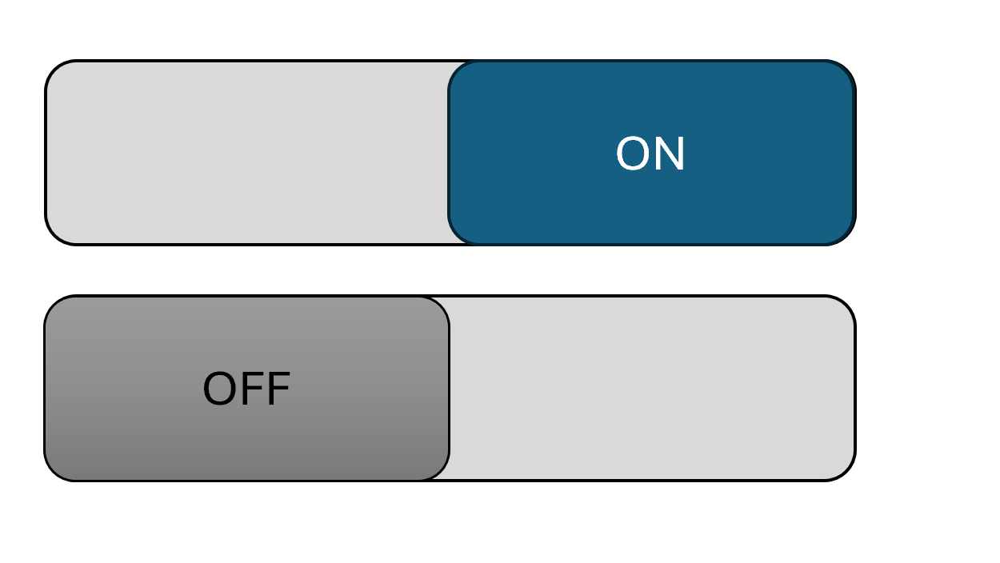
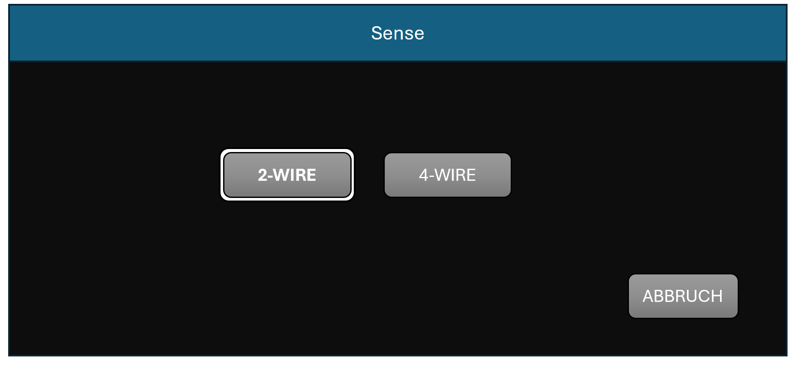
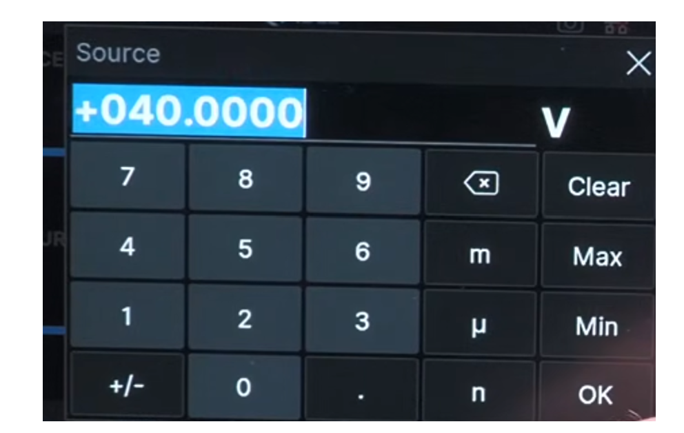
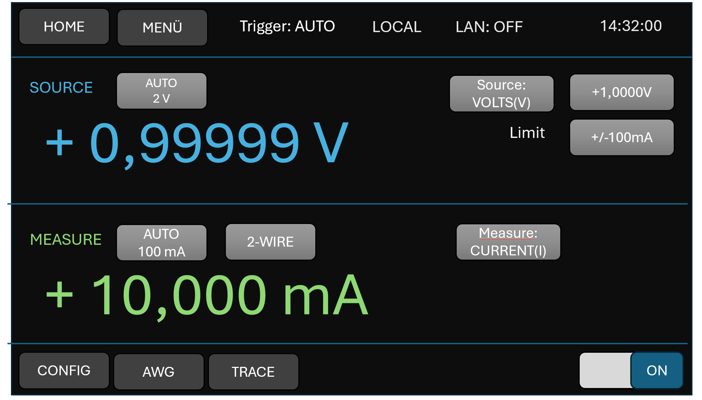

# Aktuelles Bedienkonzept: 2450-Struktur

Festlegung 20.11.2026: Die fruehere Aufteilung aus Git-Stand `02ea029` ist wieder die Basis. Die folgende Festlegung ersetzt die aelteren Siglent- und Bottom-Bar-Abschnitte in diesem Dokument.

- Obere Haelfte: Kopfzeile und dauerhaft sichtbare Messung (Spannung, Strom, Widerstand oder Leistung), Messbereich und Funktionswahl.
- Untere Haelfte: Source, Statistics oder Graph. Horizontal wischen wechselt zyklisch zwischen den drei Ansichten; die drei Punkte in der Trennleiste sind auch direkt antippbar.
- Buttons im Mess- und Source-Bereich: graue Grundfarbe RGB(122,122,122) (`#7A7A7A`), hellerer Verlauf oben, 6 Pixel Eckenradius und schwarze Schrift (`#000000`), entsprechend der 2450-Vorlage.
- Source zeigt den Messwert der Source-Groesse sowie Source-Modus, Bereich, Sollwert und Limit. Die bestehenden Eingabedialoge bleiben erhalten.
- Home kehrt zur Source-Ansicht zurueck. Menu oeffnet die vollstaendige MENU-Seite; HOME kehrt zur Hauptansicht zurueck.
- Statistics folgt der gewaehlten Messfunktion V/I/P/R: Peak to Peak, Average, Standard Dev, Span, Minimum und Maximum. Zweispaltige Darstellung nach Vorlage, darunter Range/Source/Limit und Clear Active Buffer.
- Keine Bottom-Bar und kein GUI-Output-Schalter. Der Simulationsausgang bleibt ON.
- Wischgesten brechen einen begonnenen Button-Klick ab. Die Ansicht wechselt beim Loslassen, ohne Schiebeanimation.
- Aktuelle SystemClass, Strombereiche, Simulation und Display-Pins bleiben die technische Basis. Alte Hardware-Treiber werden nicht wiederhergestellt.

Die folgenden Abschnitte dokumentieren fruehere Entwurfsstaende; bei Widerspruechen gilt die obige Festlegung.

---

# A-SMU Bedienkonzept

Version: 0.5  
Status: Konzeptentwurf, Schritt 2  
Stand: 2026-06-28  
Basis: Siglent-SMM3000X als Bedienreferenz, nicht als 1:1-Kopie

---

## 1. Einleitung

Die A-SMU soll eine ruhige, klare und schnell verständliche Oberfläche bekommen.
Die Siglent-SMM3000X-Oberfläche wird als Referenz für die Grundidee verwendet:

- oben eine schmale Toolbar,
- links eine große Source-/Measure-Anzeige,
- rechts ein Setup-Bereich für Source, Limit, Range und Output,
- unten eine Softkey-Leiste für Detailmenüs.


---

## 2. Siglent-Vorlage richtig eingeordnet

Die Siglent-Oberfläche zeigt oben in der Toolbar im Prinzip globale Bedien- und Statusinformationen.
Werte wie Source, Measure, Limit, Range und 2-Wire/4-Wire liegen nicht vollständig in der Toolbar, sondern im Hauptbereich und im Channel-Setup.

Für die A-SMU übernehmen wir daher nur das Bedienprinzip:

```text
Toolbar      = Navigation und globaler Gerätestatus
Hauptbereich = große Mess- und Source-Werte
Setupbereich = einstellbare Parameter
Softkeys     = Detailfunktionen
```

### 2.1 Seiten- und Komponentenstruktur

Die GUI wird in Pages, Panels und Popups aufgeteilt.

```text
Page  = vollständige Hauptansicht
Panel = Teilbereich innerhalb einer Page
Popup = modaler Dialog über einer Page
```

Hauptansichten werden als `Page` bezeichnet, z.B.:

```text
MainPage
AWGPage
TracePage
MainMenuPage
GraphPage
```

Panels bleiben wiederverwendbare Bausteine innerhalb einer Page, z.B.:

```text
HeaderPanel
SourcePanel
MeasurePanel
MainConfigPanel
GraphPanel
```

Popups werden für Dialoge verwendet, z.B.:

```text
NumberPadPopup
SourceRangePopup
SelectDialog
```

Die Page ist für das Layout und die Sichtbarkeit ihrer Panels verantwortlich.
Domain-Werte und Einstellungen bleiben weiterhin ausschließlich in `SystemClass`.

### 2.2 Controls

Wir müssen für die GUI verschiedene Controls erstellen.
Wir hatten in der ersten Version einen Fokus für die Buttons eingebaut. Dieser ist aus meiner Sicht jedoch nicht notwendig,
da wir bei einer Auswahl nur den aktuell selektierten Modus umrahmen müssen.

Es ist wichtig, die Farben direkt in einer zentralen Code-Datei
abzulegen, z.B.:

```text
MAIN_SCREEN_BG_COLOR
TOOLBAR_BUTTON_BG_COLOR
TOOLBAR_BUTTON_FONT_COLOR
```

---

#### 2.2.1 Boolean-Button



Der Boolean-Button wird als statischer Schiebeschalter ohne Animation umgesetzt.
Er zeigt einen klaren Zustand (`ON` / `OFF`) und ist damit kein normaler Aktionsbutton.

Einsatz: allgemeine boolesche GUI-Einstellungen. Output ON/OFF wird über den geplanten Frontplattentaster mit LED bedient (Festlegung 19.11.2026).

Regeln:

- Der Zustand kommt aus `SystemClass`.
- Eine Bedienaktion schreibt den neuen Zustand über einen Setter in `SystemClass`.
- Der Boolean-Button hat keine eigene Domain-Wahrheit.
- Der Schiebeschalter darf in der Config-Bar ohne zusätzliches Textlabel verwendet werden.
- Grafische Spezialcontrols müssen ihren EVE-Zeichenzustand kapseln, z.B. mit Save/Restore-Context, damit LineWidth, PointSize oder ColorA keine folgenden Controls beeinflussen.

#### 2.2.2 Label

Ein Label für z.B. LAN: Off oder Trigger: AUTO

#### 2.2.3 Auswahl/Umschaltung (Select-Dialog)

Für die Auswahl von z.B. dem Sense-Typ stellen wir immer einen Dialog bereit und kennzeichnen den aktuell aktiven Bereich.
Die Buttons in Auswahl-Dialogen verwenden dieselbe Hintergrund- und Schriftfarbe wie die Header-Buttons.
Diese Festlegung gilt für alle Auswahl-Dialoge, z.B. Range-, Function- und Output-Off-State-Dialoge.



#### 2.2.4 Number-Pad

Das Number-Pad dient zur Eingabe von Werten. Wird ein Wert außerhalb des gültigen Bereichs angegeben, wird der Wert in Rot dargestellt und die Eingabe kann nicht mit "OK" bestätigt werden.
Die Buttons im Number-Pad verwenden dieselbe Hintergrund- und Schriftfarbe wie die Header-Buttons.
Diese Farbregel ist bewusst Teil des UX-Konzepts und soll nicht ohne neue UX-Entscheidung geändert werden.



#### 2.2.5 Range-Button

Der Range-Button wird zweizeilig dargestellt.
Die erste Zeile zeigt, ob ein fixer Range oder Auto-Range aktiv ist.
Die zweite Zeile zeigt den aktuell verwendeten Bereich.

Beispiel bei festem Range:

```text
Range
5V
```

Beispiel bei Auto-Range:

```text
AUTO
5V
```

Bei Auto-Range zeigt die zweite Zeile immer den aktuell aufgelösten Bereich, z.B. `5V`, `30V`, `10 uA`, `1 mA`, `100 mA` oder `1 A`.


## 3. Toolbar-Konzept

### 3.1 Ziel der Toolbar

Die Toolbar soll nicht überladen werden.
Sie dient nur für globale Informationen und Navigation.


### 3.2 Vorschlag A-SMU Toolbar

```text
HOME | MENU | AUTO | LOCAL | LAN | 14:32
```


### 3.3 Bedeutung der Felder

| Feld | Bedeutung | Hinweis |
|---|---|---|
| `HOME` | zurück zum Hauptbildschirm | immer sichtbar |
| `MENU` | Hauptmenü öffnen | immer sichtbar |
| `AUTO` | Trigger-/Messstatus | Version 1 nur AUTO |
| `LOCAL` / `REMOTE` | Bedienzustand | REMOTE später über LAN/SCPI |
| `LAN` | Off | ON |
| Uhrzeit / Laufzeit | Zeitstatus | Uhrzeit oder Betriebszeit |

### 3.4 Zustände nur bei Bedarf

Warnungen werden nicht dauerhaft als Zahlen angezeigt, sondern als Statushinweis:

```text
TEMP WARN
FAN FAULT
OVP
OCP
OPEN SENSE
```

Beispiel bei Fehler:

```text
HOME | MENU | AUTO | LOCAL | LAN | FAULT: OVP
```

Die Schriftfarbe sollte sich deutlich unterscheiden:
ERROR_FONT_COLOR

---

## 4. Hauptscreen — Bereichsaufteilung

### 4.1 Grundlayout 800 √ó 480





Der Hauptscreen wird in vier Bereiche aufgeteilt:

| Bereich | Name | Aufgabe |
|---|---|---|
| A | Toolbar | globale Navigation und Status |
| B1 | Source-Anzeige | eingestellter Quellwert groß anzeigen |
| B2 | Measure-Anzeige | aktuellen Messwert groß anzeigen |
| C | Softkeys | Zugang zu Untermenüs |

---

**Festlegung 19.11.2026:** Output ON/OFF wird über einen physischen Taster mit LED in der Frontplatte bedient, unabhängig von der geöffneten GUI-Ansicht. Ein dauerhaft sichtbarer Output-Schalter in der GUI ist nicht mehr erforderlich.


---

## 5. Format-Darstellung

Wir sollten bei der Darstellung der Werte ein fixes Format vorgeben:

```text
VOLT(S)             +---,---- V  = 3,4
CURRENT(I)          +---,---- A  = 3,4
OHM(R)              +---,---- R  = 3,4
POWER(P)            +---,---- W  = 3,4

TEMP(C)             +-- C = 2,0
```

### 5.1 Hauptwerte

Die großen Source- und Measure-Werte werden fixbreit dargestellt.
Ziel ist eine ruhige Anzeige ohne horizontales Springen bei wechselnden Messwerten.

Beispiele:

```text
+000.0000 V
-000.0123 A
+001.2345 V
```

Regeln:

- Die großen Hauptwerte nutzen einen monospaced bzw. mono-geeigneten Font.
- Die Textoption `OPT_MONO` bleibt für diese Labels aktiv.
- Format für große Hauptwerte: Vorzeichen, drei Stellen vor dem Dezimaltrenner, vier Nachkommastellen.
- Dieses feste Format gilt nur für die großen Source-/Measure-Hauptwerte.
- Buttons, Popups, NumberPad, Statistik und Graph-Achsen dürfen weiterhin kompakter formatiert werden.


### 6.1 TRACE


Aufbau

A.) Toolbar wie bei Main
B.) Graph
C.) Config ( GRAPH | STATIC | ) 


#### 6.1.1 Graph
## Strombereichsauswahl – 20.11.2026

Der Bereichsdialog für Strom bietet Auto, 10 uA, 1 mA, 100 mA und 1 A in einer Reihe. Für Spannung bleiben Auto, 5 V und 30 V. Die Bezeichnungen und Grenzwerte stammen aus SystemClass. EVE-Texte verwenden wie das bestehende Number-Pad `uA` für Mikroampere.


### Vorläufiger Simulationsbetrieb – 20.11.2026

Die ON/OFF-Schalter auf Haupt- und Trace-Seite sind entfernt. Für die GUI-Entwicklung startet der simulierte Ausgang immer auf ON (`System.SetOutputOn(true)` im Setup). Die spätere Bedienung erfolgt über den Frontplattentaster mit LED; die vorgesehenen Output-Off-Zustände für die reale Hardware bleiben bestehen.


### Flache Bottom-Bar (20.11.2026)

Haupt- und Trace-Seite verwenden `ToolbarButton`, abgeleitet von `Button`, mit eigener rechteckiger Darstellung ohne 3D-Effekt. Die Leiste ist 60 Pixel hoch und liegt ohne Randabstand an der unteren Displaykante. Zwischen den Buttons liegen 4 Pixel Abstand; schmale dunkle Linien trennen sie optisch. Beschriftungen: Config, AWG, Trace sowie Graph und Statistics. Touch, Klick und Beeper bleiben in der Basisklasse; gedrueckte Buttons werden heller und die aktive Trace-Ansicht bleibt blau markiert.

Kontrastanpassung: Bildschirmhintergrund und freie Flaeche der Bottom-Bar sind schwarz (`#000000`). Die flachen Buttons bleiben grau (`#404040`) mit heller Schrift.

Die Toolbar-Buttons verwenden den FT813-Widget-Befehl mit dauerhaftem `OPT_FLAT` und expliziter Fuellfarbe (`cmd_fgcolor`); Touch-Flaechen und Positionen bleiben unveraendert.

Button-Anpassung 22.11.2026: Main- und Statistik-Buttons verwenden `GDClass::DrawRoundedGradientRect`. Beim Druecken wird der Verlauf flach. Der Radius ist pro Button einstellbar und wird auf die verfuegbare Groesse begrenzt. Die Grafikfunktion reserviert Stencil-Bit 7 als temporaere Maske und stellt den Grafikzustand nach dem Zeichnen wieder her.


## MENU-Seite - 22.11.2026

Vollbild 800 x 480. Sechs Gruppen sind in SOURCE, MEASURE, VIEWS, TRIGGER, SCRIPTS, SYSTEM angeordnet; TRIGGER und SCRIPTS sind vorerst explizit ausgeblendet. Die vier sichtbaren Spalten nutzen die verfuegbare Breite ohne Scrollen. Gruppenueberschriften sind statische Texte. Alle Funktionsbuttons sind gleich gross (183 x 52 Pixel bei vier Spalten), ohne Icons, mit dem aktuellen grauen Verlauf und schwarzer Schrift. Beim Druecken verschwindet der Verlauf als Rueckmeldung.

Mit Ausnahme von VIEWS > Graph (siehe Graph-Seite unten) oeffnen die Funktionen zunaechst eine Platzhalteransicht mit dem eindeutigen Titel GRUPPE - Funktion. BACK kehrt zum Menue zurueck; HOME fuehrt aus Menue und Platzhaltern zur Hauptansicht. Die Platzhalter aendern keine Mess- oder Source-Einstellungen.


## Graph-Seite - 22.11.2026

MENU > VIEWS > Graph oeffnet eine echte Vollbildseite. GRAPH / DATA / SCALE / TRIGGER bleiben oben, daneben der reale Simulations-/Pufferstatus. BACK fuehrt zum Menue, HOME zur Hauptansicht. Navigation und Achseneinstellungen veraendern weder Messfunktion noch Ausgangszustand.

- GRAPH: schwarzer Hintergrund, graues Raster mit 10 X- und 6 Y-Teilungen. Die zuerst gewaehlte Kurve ist gruen. V, I, P und R koennen in der Zeitansicht gemeinsam eingeblendet werden; jede hat ihre eigene Y-Skala, Achsenwerte und Auswertung folgen der oben ausgewaehlten Kurve. I/V stellt den Strom ueber der gleichzeitig gemessenen Spannung dar.
- DATA: einzige derzeit vorhandene Datenquelle ist der aktive Messpuffer. Kurvenauswahl, Add/Remove, Linie/Punkte/beides und Zeit/I-V. Remove behaelt den Messpuffer. Clear measurement buffer leert ihn explizit ueber SystemClass; laufende Messung/Simulation fuellt ihn erneut.
- SCALE: X/Y-Start und Wert pro Teilung per eigener Zahleneingabe in Basiseinheiten (s, V, A, W, Ohm), mit wissenschaftlicher E-Notation. Divisionen muessen positiv und endlich sein. Zeitfenster mitlaufend oder vollstaendiger gespeicherter Puffer; das mitlaufende Fenster ist einstellbar. Zeitbezug ist der erste Graph-Messpunkt, kein Sample-Index.
- Ziehen im Diagramm verschiebt bei ausgeschalteter Cursorbedienung die Achsen; ZOOM +/- zoomt um die Mitte. Beide Aktionen schalten Autoskalierung ab. AUTO SCALE aktiviert sie erneut. Einstellungen bleiben beim Reiterwechsel und beim Verlassen/Wiederoeffnen der Seite erhalten.
- Untere Leiste: SCALE zeigt Achsen und Werte/Teilung. STATS zeigt Min/Max/Mittelwert/Populationsstandardabweichung der gewaehlten Groesse ueber den gesamten gespeicherten Puffer. CURSOR erlaubt Off/Vertical/Horizontal/Both; Move A/B waehlt den Cursor zum Verschieben per Touch. X/Y-Positionen und dX/dY werden mit Einheiten angezeigt (dX/dY steht fuer Delta X/Y). Cursorlinien sind frei positionierbare Auswertungshilfen, ohne automatische Bindung an einen Messpunkt.
- TRIGGER: kontinuierliche Simulation bzw. vorhandener Puffer wird angezeigt. Hardware-Trigger, Single und Templates fehlen bisher und bleiben sichtbar als deaktivierte Platzhalter.
- Puffergrenze: maximal 1024 Messpunkte, kein unbegrenztes Messarchiv. Kurven werden fuer die FT813-Displayliste als zeitlich geordnete Min/Max-Huelle verdichtet. Ein-/Ausgangsdaten, Statistik und Puffer werden dabei nicht veraendert; ungueltige Abschnitte werden nicht durch Linien ueberbrueckt. Zoomen berechnet die Verdichtung fuer den sichtbaren Zeitbereich erneut.
- Wiederverwendbare Raster-, Linien-/Punktdarstellung und Clipping liegen hinter GDClass; GraphState kapselt ausschliesslich Darstellungszustand und Achsenmathematik.

Bedienreferenz: die vom Nutzer beschriebene Keithley-2450-Struktur. Die verlinkten Referenz-PDFs konnten wegen ihrer Groesse nicht ueber das Web-Werkzeug geladen werden; es wurde keine vollstaendige Uebereinstimmung mit dem Originalgeraet verifiziert.

Grafikkorrektur 22.11.2026: `GDClass::DrawRoundedGradientRect` begrenzt Verlauf und Stencil-Loeschvorgang zusaetzlich auf das Button-Rechteck mittels Scissor. Dies verhindert Zeichnen ausserhalb der Buttons; der vorherige Grafikzustand wird danach wiederhergestellt.

Graph-Korrektur 22.11.2026: I-V hat eine eigene Sichtbarkeit und Y-Skala. Beim Rueckwechsel zur Zeitansicht werden deren vorherige Kurvenauswahl und Y-Skalen wiederhergestellt; I-V schaltet keine zusaetzliche Zeitkurve ein. Graph-Texte, Achsen und Buttons verwenden Schriftgroesse 27, mit mehr Platz fuer die Y-Achsenwerte.


Tab-Control 22.11.2026: Die Graph-Seite nutzt ein wiederverwendbares TabControl mit den Titeln Graph, Data, Scale und Trigger. Aktiver Reiter helles Petrol, inaktive Reiter dunkles Petrol, weisse Schrift, schraege rechte Kante und durchgehende Akzentlinie. Druecken wird durch eine hellere Farbe sichtbar. Die Form zeichnet GDClass.DrawTabShape. Graph-Texte, Achsen und Buttons sind auf Schriftgroesse 28 erhoeht; links ist mehr Platz fuer Achsenwerte. Tabwechsel veraendern nur die Ansicht, nicht Puffer, Graph-Einstellungen oder Ausgangszustand.


### Graph: Zwei-Finger-Zoom (2026-11-22)
- Die GDClass liest die fünf kalibrierten FT813-Touchslots im Extended-Modus; TouchFrame enthält Koordinaten und Slot-IDs.
- Zwei Finger innerhalb des Diagramms starten Pinch-Zoom für X und alle Y-Skalen, verankert an der anfänglichen Fingermitte. Spreizen zoomt hinein, Zusammenziehen heraus; Autoscale wird deaktiviert.
- Ein Finger verschiebt wie bisher das Diagramm oder den gewählten Cursor. AUTO SCALE stellt die Automatik wieder her. Die Zoom-Buttons entfallen.
- Nach Multitouch werden Eingaben bis zum vollständigen Loslassen gesperrt. Dritter Finger oder gewechselte Touchslots beenden den Zoom; ausstehende Button-Klicks werden verworfen.
- Die Touch-Kalibrierung muss bei einer späteren Implementierung im Compatibility-Modus erfolgen. Prüfung am echten Display steht noch aus.


### Modale Scale-Eingabe (2026-11-22)
- X/Y-Start, X/Y pro Rasterteilung und Zeitfenster öffnen jetzt ein zentriertes 600 × 430-Pixel-Fenster über der abgedunkelten Scale-Seite.
- Fenstergröße, Farben und Ziffern-/Aktionstasten entsprechen der Main-Page-Eingabe. Beide Eingaben nutzen GDClass::DrawModalWindow für den gemeinsamen Fensterrahmen.
- Graph-Werte bleiben in Basiseinheiten mit E-Eingabe für Exponenten. OK validiert und übernimmt, Cancel verwirft. Ungültige Eingaben lassen den Dialog geöffnet.
- Während der Eingabe sind Hintergrundbuttons, Tabs und Pinch-Zoom gesperrt.
- Zwei-Finger-Zoom wurde vom Nutzer auf dem echten Display erfolgreich bestätigt.


### Korrektur Dialog-Rendering (2026-11-22)
- Nach dem ersten Modal-Umbau meldete der Nutzer einen Stillstand ohne sichtbaren Dialog. Verdacht: zu große EVE-Display-Liste durch Hintergrund und native 3D-Tasten; nicht am Gerät vermessen.
- Zahlen-Dialoge verwenden jetzt kompakte, abgerundete Vollfarb-Tasten mit dunkler Druckrückmeldung. Die GDClass zeichnet die Fläche mit einer festen Anzahl einfacher Display-List-Befehle statt CMD_BUTTON.
- Main- und Graph-Eingabe nutzen dieselbe kompakte Darstellung. Vollständig vom Graph-Dialog verdeckte Hintergrundbuttons werden nicht gezeichnet.
- Host-Regression prüft 17 kompakte Dialogtasten und keine nativen CMD_BUTTON-Aufrufe im Scale-Dialog; Hardware-Nachtest erforderlich.


### Native flache Dialogbuttons (2026-11-22)
- Auf Nutzerwunsch ersetzen native CMD_BUTTON-Tasten mit OPT_FLAT die zuletzt eingeführten selbst gezeichneten Dialogtasten, sowohl für Main- als auch Scale-Eingaben.
- Button::SetNativeFlat aktiviert die Darstellung über GDClass; ein dunklerer Hintergrund bestätigt das Drücken. Modale Sperre, Tastaturlayout und Auslassen vollständig verdeckter Hintergrundbuttons bleiben erhalten.
- GDClass meldet nach abgeschlossenen Frames neue Höchststände als `EVE DL peak: … / 8192 bytes` im seriellen Monitor. Das ist eine Messung am Gerät, keine garantierte Speicherersparnis durch OPT_FLAT.
- Host-Test prüft alle 17 Graph-Dialogtasten auf native flache Darstellung sowie den Farbwechsel beim Drücken. Hardwareprüfung und Speicherbelegung stehen aus.


### MainPage: native 3D-Buttons zur Sichtprüfung (2026-11-22)
- Measure-Funktion/Range, Source-Modus/Range/Value/Limit (V und I) sowie Clear Active Buffer nutzen native EVE-Buttons statt eigener abgerundeter Verlaufsflächen.
- Im Ruhezustand ohne OPT_FLAT; beim Drücken bleibt die bisherige flache Druckrückmeldung erhalten. HOME und MENU waren bereits native Buttons.
- Farben, Schrift und Positionen bleiben für den direkten Vergleich erhalten. Zahlen-Dialoge bleiben vorerst nativ flach. Die flache Source-Kopfleiste ist ein Hintergrund, kein umzustellender Funktionsbutton.


### Einheitliche native EVE-Buttons (2026-11-22)
- Nach erfolgreicher MainPage-Sichtprüfung verwenden auch Menü, Graph, Zahlen-Dialoge und ToolbarButtons native CMD_BUTTON mit 3D-Effekt im Ruhezustand. Auswahldialoge verwendeten diesen Pfad bereits.
- Hintergrund-/Schriftfarben sowie Auswahl- und Disabled-Markierungen bleiben erhalten. Beim Drücken wird OPT_FLAT als Druckrückmeldung gesetzt.
- Spezielle Tab-Control-Reiter und Boolean-Schalter bleiben eigenständige Controls; die Source-Kopfleiste bleibt eine flache Hintergrundfläche.
- Graph-Modal blendet weiterhin vollständig verdeckte Hintergrundbuttons beim Zeichnen aus. Die reale Display-List-Belegung kann über EVE DL peak im seriellen Monitor geprüft werden; der vollständige Hardware-Nachtest steht aus.


### Verbindliche Dialogvorlage und Scale-Hintergrund (2026-11-22)
- Nutzerentscheidung: Alle Dialoge orientieren sich an **SET LIMIT** (auch dauerhaft in AGENTS.md festgehalten).
- Nach erneutem Stillstand des Scale-Dialogs mit nativen 3D-Buttons wird der letzte sichtbare Bildschirm einmal als RGB565-Bitmap zwischengespeichert. Die modale Display-Liste enthält dieses Bild und die 17 nativen Dialogtasten, keine Hintergrundbuttons oder Scale-Texte.
- GDClass kapselt asynchrones CMD_SNAPSHOT2 und Bitmap-Ausgabe. Keine blockierende EVE_execute_cmd-Schleife; während der Aufnahme läuft die Hauptschleife weiter.
- Reserviert: Bitmap-Handle 0 und RAM_G ab 0x40000, bei 800×480 genau 768000 Byte bis exklusiv 0xFB800. Der Bereich darf nicht von anderen Grafikassets belegt werden. Keine zusätzliche Pico-RAM-Bildkopie.
- Ursache ohne Controller-Log weiterhin nicht abschließend gemessen; Host-Test prüft einen Aufnahmeauftrag pro Öffnen und ausschließlich 17 native Dialogtasten. Hardware-Nachtest erforderlich.


### Hardware-Bestätigung Dialoge (2026-11-22)
- Nutzer bestätigt: Alle Dialoge funktionieren nach dem Bitmap-Hintergrund-Umbau korrekt.
- Gemessener Höchststand: EVE DL peak 6064 / 8192 Byte (74,0 %, verbleibend 2128 Byte beim gemessenen Höchststand).
- SET LIMIT bleibt die verbindliche Gestaltungsvorlage.


### Graph-Verschieben über mehrere Messgrößen (2026-11-22)
- Pan verschiebt alle sichtbaren Kurven um denselben Bildschirmanteil auf ihrer jeweiligen Y-Skala, statt ausschließlich die ausgewählte Messgröße zu verschieben.
- Auch die ausgewählte Achse bewegt sich mit, falls ihre Kurve unter DATA ausgeblendet ist. Andere ausgeblendete Y-Skalen behalten ihren Startwert. Gemeinsame X-Achse und Abschalten der Automatik bleiben erhalten.
- Neue Achsenwerte werden vor dem gemeinsamen Übernehmen validiert. Regression deckt V/I/P/R-Auswahl, mehrere sichtbare Kurven, ausgewählte ausgeblendete Stromkurve und I/V ab.


### MainPage-Diagramm mit neuem Renderer (2026-11-22)
- Das kompakte GraphPanel verwendet nun GraphState und GDClass::DrawPlotGrid/DrawPlotSeries wie die große Graph-Seite: schwarzer Hintergrund, dezentes Raster, grüne Kurve, Achsenwerte in Engineering-Einheiten und eine echte Zeitachse.
- Automatisches 10-s-Zeitfenster, ausgewählte Messgröße aus SystemClass (V/I/P/R), Auswertung des gespeicherten Puffers statt nur der letzten 200 Werte. Die Min/Max-Hüllkurve begrenzt die Zeichenpunkte auf 96 und erhält Spitzen und Datenlücken.
- Buttons, Seitenwechsel per Swipe/Navigationspunkten und MainPage-Layout bleiben erhalten. Es werden keine GraphPage-Tabs oder Zusatzbuttons eingebaut; Touch-Gesten des MainPage-Seitenwechsels bleiben unverändert.


### MainPage: gemeinsame Darstellung und Gesten (2026-11-22)
- Line / Points / Both kommt in beiden Diagrammen aus den zentralen GraphSettings der SystemClass. Änderungen unter MENU → Graph → Data wirken auch auf MainPage.
- Im Plotbereich verschiebt ein Finger, zwei Finger zoomen. Manuelle Achsen bleiben beim Zeichnen und bei neuen Messpunkten erhalten. Doppeltipp im Plot stellt Autoscale wieder her; keine neuen Buttons.
- Ein im Plot begonnener Drag wird nicht als MainPage-Seitenwechsel behandelt. Navigationspunkte und Swipes außerhalb der Plotfläche bleiben erhalten.
- Neue Multitouch-Gesten werden nur an die oberste sichtbare Seite weitergeleitet; offene Dialoge sperren den dahinterliegenden Graph. Nach einer Mehrfinger-Geste muss vollständig losgelassen werden.


### MainPage ohne Pinch-Zoom (2026-11-22)
- Auf Nutzerwunsch ist der Zwei-Finger-Zoom im MainPage-Diagramm deaktiviert. Mehrfingerkontakte werden bis zum vollständigen Loslassen verworfen, ohne Achsen, Seitenwechsel oder Doppeltipp auszulösen.
- Ein-Finger-Verschieben, Doppeltipp für Autoscale und gemeinsame Line/Points/Both-Einstellung bleiben bestehen. Der Zoom unter MENU → Graph bleibt verfügbar. Keine Änderung am Verhalten der Zeitachse.


### Histogramm-Seite (2026-11-22)
- MENU → VIEWS → Histogram öffnet eine eigene Seite mit Histogram/Data/Scale-Tabs, SIM/BUF-Status, AUTO SCALE, BACK zum Menü und HOME zur Hauptansicht. Die bestehenden Buttons und TabControl folgen dem Graph-Stil.
- Schwarze Diagrammfläche, graues Raster und grüne Balken über GDClass::DrawHistogramBars. X zeigt Messwertintervalle mit Engineering-Einheit, Y die Häufigkeit. Zwei zusätzliche Klassen sammeln Werte unter/über den Grenzen; < und > kennzeichnen sie.
- Unter dem Diagramm stehen Quelle, Messgröße, gültige Anzahl, reguläre Klassenanzahl (+2 Ausreißer), Breite, wirksame Unter-/Obergrenzen, tatsächliche Datenextrema und ungültige Messwerte. Antippen einer belegten Klasse öffnet Intervall und Anzahl als Momentaufnahme in einem SET-LIMIT-gestalteten Modal.
- DATA: Messgröße wählen, vorhandenen Active Buffer auswählen, Quelle hinzufügen/entfernen und Messpuffer separat löschen. Es wird kein zweiter Puffer vorgetäuscht.
- SCALE: Minimum, Maximum, Number of Bins und optional Y Maximum über NumericEntryDialog; SmartScale/Auto Bin/Fit/Off über native EVE-Buttons. NumericEntryDialog verwendet das SET-LIMIT-Layout und den gespeicherten Hintergrund. Off kann Balken abschneiden, deren exakte Anzahl weiterhin im Detaildialog steht.
- Im Hintergrund neue Messwerte werden bei jedem Histogramm-Frame neu einsortiert; beim geöffneten Detail-/Eingabedialog bleibt dessen Anzeige stabil. Einstellungen liegen zentral in SystemClass und bleiben bei Navigation/Buffer-Löschen erhalten. Keine neuen Ausgangsaktionen oder Triggerfunktionen.
- Grundlage: Keithley 2450 Reference Manual, Rev. E, Abschnitt Histogram/Scale: https://download.tek.com/manual/2450-901-01E_Sept_2019_Ref.pdf (relevante Tabelle über die indexierte Herstellerquelle gelesen; PDF-Direktabruf überschritt das Größenlimit). Die konkrete SmartScale-Auswahlregel ist unter system.md dokumentiert.
- Host-Prüfung: Grenzzuteilung inklusive Maximum, Ausreißer, NaN/Inf, ungültiger Widerstand, leere/konstante Daten, 64 Klassen, Ringpufferüberlauf, modale Validierung, Add/Remove/Clear, Menüroute und unveränderter Ausgang. Visuelle und Touch-Prüfung am FT813 nach Upload erforderlich.


### Reading Table (2026-11-22)
- MENU → VIEWS → Reading Table öffnet die Tabelle im bestehenden 800×480-Stil. BACK führt zum Menü, HOME zur Hauptansicht; Navigation ändert den Ausgang nicht.
- Blaue Titelleiste, Active-Buffer-Auswahl und grüne Kurvenvorschau über der Tabelle. Es gibt derzeit nur den aktiven Messpuffer; der Auswahldialog kennzeichnet dies ausdrücklich.
- Acht Zeilen pro Seite mit Index, relativer Zeit in Sekunden sowie Voltage, Current, Power und Resistance in Engineering-Einheiten. Ungültige Werte erscheinen als Striche. Die gewählte Zeile und der Marker in der Vorschau sind rosa.
- Previous/Next sowie First/Last blättern in einer gehaltenen Momentaufnahme. HOLD hält die Ansicht, LIVE folgt wieder den neuesten Messpunkten. Die Erfassung läuft in beiden Fällen weiter. Seitenposition und Hold bleiben bei Navigation erhalten.
- Antippen einer Zeile öffnet deren vollständigen Index, Zeit und vier Werte im SET-LIMIT-gestalteten Detaildialog. Ein Tipp in die Vorschau wählt den zeitlich nächstliegenden Messpunkt und dessen Tabellenseite. Kein Pinch-Zoom.
- GDClass::DrawTableGrid kapselt das wiederverwendbare Tabellenraster. Die Vorschau nutzt denselben Graph-Renderer und dieselbe Line/Points/Both-Einstellung wie die anderen Diagramme; die Hüllkurve ist hier auf höchstens 48 Zeichenpunkte begrenzt.
- Host-Tests prüfen Ringpufferüberlauf, fortlaufende Indizes, Zeitstempelüberlauf, leere Daten, Hold trotz Erfassung/Buffer-Reset, Paging, Vorschauauswahl, modale Touch-Sperre und Menü/BACK/HOME. Die Darstellung und Displaylistenbelegung sind nach Upload am FT813 zu prüfen.


## Simulation-Seite – 22.11.2026
- MENU → SYSTEM → Simulation öffnet eine eigene Seite im 800×480-Stil mit nativen EVE-Textbuttons. SYSTEM erhält einen sechsten Eintrag; alle Menübuttons sind einheitlich 44 Pixel hoch. BACK führt zum Menü, HOME zur Hauptansicht. Navigation ändert weder Last noch Ausgang.
- SIMULATION ON/OFF wählt den Simulationsbetrieb. OFF zeigt NO HW/NO HARDWARE und OUTPUT OFF, da der reale Treiber noch fehlt. SIM ist in der MainPage-Kopfzeile und auf Menü, Graph, Histogramm, Reading Table und Simulation sichtbar. Die MainPage-Kopfzeile zeigt zusätzlich CV/CC, OVERRANGE oder den Fehlerstatus.
- RESISTOR/OPEN/SHORT als drei Textbuttons. Widerstand über einen SET-LIMIT-gestalteten Zahlen-Dialog; Ohm/kOhm/MOhm wählen die Eingabeeinheit. Null, negative und nicht endliche Widerstände werden abgewiesen. Der gespeicherte Widerstand bleibt beim Wechsel zu OPEN/SHORT erhalten.
- Die sechs Bereichsbuttons schalten ausschließlich die Verfügbarkeit. Der aktuell verwendete Bereich ist ausgegraut und gesperrt. Für dessen Deaktivierung zuerst über Main einen anderen Bereich wählen. Abgeschaltete Bereiche sind in der normalen Bereichsauswahl ebenfalls deaktiviert.
- Sollwert, Compliance und aktive Bereiche bleiben auf den normalen Geräteseiten. Die Simulation-Seite zeigt live U, I, P, OUTPUT und CV/CC sowie Overrange/Fehler. Ohne gültige Messung erscheinen Striche.
- Die Last ist statisch: Ohne Eingabeänderung sind horizontale Kurven und schmale Histogramme zu erwarten. Stromquellenbetrieb wird in dieser ersten Version ausdrücklich als MODE UNSUPPORTED angezeigt.
- Host-UI-Tests prüfen Menüroute, Bereichssperre, Lastwahl, Widerstand in kOhm, Zurückweisung von Null und SIM-Umschaltung. Pico-Build erfolgreich; Optik, Touch und EVE-DL-Peak müssen nach Upload am Display geprüft werden.


### Simulationsrauschen – 22.11.2026
Die Simulation enthält jetzt gleichverteiltes relatives Messrauschen von ±0,01 % für Spannung und Strom mit getrennten Pseudozufallsfolgen. Es wird nach dem idealen Last-/Compliance-Modell aufgebracht; CV/CC wird weiterhin vom idealen Modell bestimmt. Die gemessenen Werte können deshalb geringfügig über Sollwert oder Compliance liegen. Leistung und Widerstand werden aus den verrauschten U/I-Werten berechnet; OVERRANGE bezieht sich ebenfalls auf die verrauschten Messwerte. Nullwerte bleiben null (auch OPEN-Strom, SHORT-Spannung und OUTPUT OFF).

Die Rauschwerte werden aus Zeitstempel und Kanal abgeleitet: Wiederholte Reads desselben Zeitpunkts bei AUTO-Range liefern identisches Rauschen. Kein zusätzlicher Rauschpuffer oder Zufallsgeneratorzustand; die Messkadenz bleibt unverändert. Gemeinsamer Messdatensatz für Anzeige und Auswertungen. ±0,01 % bezeichnet die Amplitudengrenze relativ zum Messwert, nicht zum Messbereich und nicht den RMS-Wert.


### Stabile Zeitkurven bei laufender Erfassung – 22.11.2026
Fehlerkorrektur: Die bisherige Min/Max-Verdichtung teilte alle sichtbaren Samples bei jedem Frame neu in bis zu 32 gleich große Gruppen nach Sampleanzahl ein. Ab dem 33. Punkt konnten dadurch ältere Spitzen verschwinden oder anders verbunden werden, obwohl die gespeicherten Daten unverändert waren.

Zeitkurven verwenden jetzt feste Zeitintervalle innerhalb des aktuellen X-Achsenausschnitts. Bei unveränderter X-Achse ändern angehängte Messpunkte keine bereits abgeschlossenen Intervalle. Das noch offene Intervall darf sich ergänzen; bei Scrollen/Zoom oder automatisch wachsender Gesamthistorie wird der veränderte Ausschnitt neu abgebildet. Min/Max, Datenlücken und Nachbarpunkte zum Clipping bleiben erhalten. Maximal 66 Zeichenpunkte bei 32 Intervallen, weiterhin unter dem vorhandenen 96-Punkte-Limit; keine zusätzlichen dauerhaften RAM-Puffer. I-V behält die chronologische Gruppierung, weil Spannung dort nicht monoton sein muss.

Regression: Neun Sekunden echte Simulationsdaten werden schrittweise angehängt; bisherige Buffer-Samples und die Zeichenpunkte abgeschlossener Zeitintervalle werden vor/nach jedem neuen Sample verglichen. Der Test schlug mit der alten Gruppierung fehl und besteht mit der Korrektur.


### Full buffer als Standard und ruhige Achsen – 22.11.2026
MainPage und MENU/Graph starten jetzt mit Full buffer. Die Zeitachse zeigt den vorhandenen Verlauf und erweitert ihre Spanne in 1/2/5-Stufen (standardmäßig mindestens 10 s, danach 20/50/100 s). Der linke Rand bleibt beim ersten erhaltenen Messpunkt; nach Überschreiben des Ringpuffers rückt dieser weiterhin vor. Unter SCALE heißt die bisherige Window-Einstellung in Full buffer nun Min span.

Ursache des verbleibenden Kurvenwanderns: Die zuvor korrigierten Zeitintervalle waren nur bei unveränderter X-Achse stabil. Full buffer passte deren Breite bisher bei jedem neuen Sample an. Stufenweise Erweiterung verhindert dieses ständige Umgruppieren. Bei einem tatsächlichen Wechsel der Zeitspanne wird die Kurve neu skaliert und verdichtet; dies ist keine Änderung an den Messwerten.

Automatische Y-Achsen behalten ihre Grenzen, solange neue Daten hineinpassen. Nur außerhalb liegende Werte erweitern die Grenzen mit Reserve. AUTO SCALE passt ausdrücklich erneut eng an die Daten an. Konstante Startdaten etablieren noch keine dauerhafte Rauschspanne. Manuelle Achsen bleiben unverändert. Die kleine Reading-Table-Vorschau überspannt weiterhin exakt ihre Daten, passend zur Auswahl per Antippen.

Host-Regression prüft zusätzlich den Full-buffer-Standard, unveränderte alte Kurvenpunkte beim Anhängen zwischen 4 und 9 s, gleichbleibende Y-Achsen bei Werten innerhalb der Grenzen, Erweiterung bei Ausreißern und erneutes Einpassen mit AUTO SCALE.


### Schrittweise Zeitachse als Standard – 22.11.2026
Ersetzt den zuletzt gewählten Full-buffer-Standard: Main und MENU/Graph starten mit Step scrolling, 10 s Fensterbreite und 2 s Schrittweite. Bis einschließlich t=10 s bleibt der Ausschnitt 0–10 s; der erste spätere Messwert verschiebt ihn auf 2–12 s, anschließend 4–14 s usw. Bei verzögerten Frames werden erforderliche Schritte direkt nachgeholt. Die X-Skalierung bleibt gleich.

SCALE bietet weiterhin Full buffer als Alternative. Window bestimmt im Step-scrolling-Modus die Breite; die Schrittweite beträgt 20 % davon (5 s Fenster → 1 s Schritt). Manuelle Skalierung/Pan bleiben bis AUTO SCALE bestehen. Die ruhige Y-Automatik bleibt erhalten.

Die Verdichtung verwendet jetzt am Zeitursprung ausgerichtete Intervalle, damit auch beim Fenstersprung Spitzen im überlappenden, vollständig sichtbaren Bereich gleich bleiben. Höchstens 33 Intervalle plus Clipping-Nachbarn (68 Punkte), weiterhin innerhalb des bestehenden 96-Punkte-Limits. Messpuffer und Erfassung werden nicht geändert.


### Kompakter Messpuffer: P/R dynamisch – 22.11.2026
Ersetzt die bisherige Speicherung von Leistung und Widerstand: Hardware::Measurement / BufferSample enthält nur noch U, I, Zeitstempel, CV/CC, Ausgangs-/Overrange-Flags und Fehlerstatus. Größe jetzt 16 statt 24 Byte; der Ringpuffer mit unverändert 1024 Punkten benötigt 16 statt 24 KiB. Auch alle Sample-Kopien in den Ansichten sind entsprechend kleiner.

GetPower() berechnet U·I und GetResistance() U/I bei Bedarf zentral im Hardware-Datentyp. Widerstandsgültigkeit wird ebenfalls abgeleitet (endliche Werte, |I| mindestens 1 nA, endlicher Quotient); ein eigener Gültigkeitswert wird nicht mehr gespeichert. Die Ansichten prüfen diese Gültigkeit und zeigen bei ungültigem R weiterhin Striche. Fehlerhafte Samples werden von den Auswertungen weiterhin ausgelassen.

Main, Statistik, Graph, Histogramm, Simulation, Reading Table und XY-Vorschau verwenden dieselben dynamischen Berechnungen. Statistik wertet P/R weiterhin pro einzelnem Messpunkt aus, niemals aus gemittelten U/I-Werten. Unbenutzte SetPower/SetResistance und die bisherige Aktualisierung abgeleiteter Cache-Werte wurden entfernt. Keine Änderung an Messrate, Rauschen, Fensterbreite oder Ringpufferkapazität. Host-Tests prüfen 16-Byte-Layout, dynamische Werte nach U/I-Änderung, Null-/ungültige Ströme sowie alle bisherigen Auswertungen.


### Standardfenster 100 Sekunden – 22.11.2026
Der Standard für MainPage und MENU/Graph beträgt jetzt 100 s bei 10 Rasterteilungen, also 10 s/div. Step scrolling verschiebt weiterhin um 20 % der Fensterbreite: 0–100 s → 20–120 s → 40–140 s. Diese Vorgabe ersetzt das frühere 10-s-Standardfenster. Pufferkapazität (1024 Samples), Messrate und ruhige Y-Automatik bleiben unverändert.


### Schrittweite genau eine Rasterteilung – 22.11.2026
Nutzerkorrektur: Step scrolling verschiebt um genau Window / XDivisions, nicht mehr um 20 %. Beim Standardfenster 100 s mit 10 Rasterteilungen sind das 10 s: 0–100 → 10–110 → 20–120 s. Bei anderer Fensterbreite bleibt der Schritt ebenfalls genau eine Rasterteilung. Messrate, Puffer und Y-Automatik bleiben unverändert.


### Vollständige Messpunkte als Pixelkurven – 22.11.2026
Die starke 32-Intervall-Verdichtung führte bei 100 s Fensterbreite zu nur wenigen dargestellten Werten in den ersten 10 s. Main-Graph, MENU/Graph und Reading-Table-Vorschau verwenden jetzt GDClass::DrawPlotTrace mit einem generischen PlotPointSource. Alle gültigen Samples (maximal 1024) werden gelesen und direkt in ein einfarbiges 1-Bit-Pixelbild gezeichnet. Keine Min/Max-Auswahl in diesen drei Ansichten; nahe Punkte können aufgrund der Displayauflösung natürlich auf dieselbe Pixelspalte fallen. Line/Points/Both, Datenlücken und Clipping bleiben erhalten.

PlotRaster enthält die wiederverwendbare, SMU-unabhängige Rasterisierung. GraphState::Trace liefert daraus nur Koordinaten und Gültigkeit aus den gespeicherten Daten. Das ältere MakePoints bleibt als begrenzte Hüllkurven-API erhalten, wird von den drei Ansichten aber nicht mehr verwendet. Drei bisherige PlotPoint-Arrays wurden entfernt.

GDClass verwendet einen gemeinsamen 25.600-Byte-Arbeitspuffer, maximal vier Kurven pro Frame, Bitmap-Handles 16–19 und zwei wechselnde RAM_G-Bänke (je vier Slots à 25.600 Byte, insgesamt Adressen 0 bis exklusiv 204800). Der Modal-Snapshot ab 0x40000 und ROM-Font-Handles 1/2 bleiben frei. L1-Bitmaps werden per SRC_ALPHA / ONE_MINUS_SRC_ALPHA eingefärbt; Nullbits sind transparent. Der aktive Bildspeicher wird während des nächsten Frame-Aufbaus nicht überschrieben. Die Displayliste wächst nicht mehr mit der Messpunktzahl. Der Bildtransfer verursacht zusätzliche SPI-Zeit, besonders bei vier Kurven.

Host-Tests prüfen alle 100 Punkte der ersten 10 s im Pixelbild, unveränderte Messdaten, Moduswahl, Clipping und Unterbrechungen durch ungültige Daten. EVE-Ausgabe, Farbkomposition und Touch-Reaktionszeit müssen nach Upload am Display geprüft werden.


### L1-Transparenz korrigiert – 22.11.2026
Die erste Bitmap-Version verwendete irrtümlich ONE/ONE-Blending und zeichnete dadurch eine gefüllte Fläche. FT813 L1 enthält ein Alpha-Bit und keine RGB-Farbbits. DrawPlotTrace verwendet jetzt SRC_ALPHA / ONE_MINUS_SRC_ALPHA: Nullbits erhalten Hintergrund und Raster, gesetzte Bits zeichnen die Kurvenfarbe. Quelle: FT81X Series Programmer Guide, BITMAP_LAYOUT-Formattabelle, https://brtchip.com/wp-content/uploads/Support/Documentation/Programming_Guides/ICs/EVE/FT81X_Series_Programmer_Guide.pdf . Die tatsächliche Ausgabe muss am Display nachgetestet werden.


### Main-Diagramm ohne Verschieben – 22.11.2026
Zusätzlich zum bereits deaktivierten Pinch-Zoom ist nun auch Ein-Finger-Pan im Main-Diagramm deaktiviert. Drags innerhalb der Plotfläche werden konsumiert und ändern weder Achsen noch Ansicht; sie gelten nicht als Tipp. Automatische Zeitfenstersprünge und Doppeltipp für AUTO SCALE bleiben erhalten. Die große MENU/Graph-Seite behält Zoom und Verschieben.


### Main-Slide über der Diagrammfläche wiederhergestellt – 22.11.2026
Korrektur der Touch-Zuordnung: Horizontales Wischen über dem Main-Diagramm wechselt wieder Source/Statistics/Graph. Die Kurve selbst bleibt gegen Pan/Zoom gesperrt. SourcePanel übernimmt Swipes auch innerhalb der Plotfläche; kurze Taps gehen weiter an GraphPanel. Vertikale Bewegungen und abgebrochene Gesten wechseln keine Seite. Mehrfingerkontakte bleiben gesperrt.


### Lesbare Diagrammachsen – 22.11.2026
Main und MENU/Graph beschriften die Zeitachse jetzt als MM:SS (100 s → 01:40). Minuten laufen über 59 hinaus; negative manuelle Ausschnitte erhalten ein Minuszeichen. Bei Beschriftungsabständen unter einer Sekunde kommen passend zum Zoom Nachkommastellen hinzu. I-V behält Spannungswerte auf X.

Automatische Werteachsen werden auf 1/2/2,5/5-Schritte pro Dekade mit ausgerichtetem Startwert eingepasst. Die Beschriftung verwendet ein gemeinsames Engineering-Präfix pro Achse und zur Rasterweite passende Nachkommastellen statt pauschal vier signifikanter Stellen. So werden bei etwa 100 mV und ±0,01 % Rauschen unterschiedliche Rasterwerte lesbar (z. B. 99,985 / 99,990 / 99,995 / 100,000 mV). Die ruhige Y-Automatik und manuelle Achseneinstellungen bleiben erhalten.

Host-Tests prüfen MM:SS inklusive Minutenübertrag, negative Zeiten, Subsekundenformat und eindeutig unterschiedliche Ticktexte für den engen 100-mV-Bereich.


### Main-Y-Achse enger eingepasst – 22.11.2026
Nur das kompakte Main-Diagramm verwendet tightYAxis: tatsächliches Minimum/Maximum mit 5 % Reserve pro Seite, ohne zusätzliches Aufrunden der Achsengrenzen auf schöne Rasterwerte. Die Skala bleibt stabil, solange die Werte hineinpassen und mindestens 75 % der Höhe belegen; andernfalls wird neu eingepasst. Die große Graph-Seite behält ihre gerundeten Rasterabstände. Die Beschriftung berücksichtigt auch ungerade Rasterweiten mit begrenzter zusätzlicher Genauigkeit, damit die Texte in die Achsenleiste passen.


### Pico-kompatible Zeit-/Indexausgabe – 22.11.2026
Die bisher verwendeten printf-Formate %llu und %02llu wurden auf dem Pico als lu/0lu ausgegeben. Zeitachse und Reading-Table-Index (einschließlich Detaildialog) verwenden jetzt DisplayFormat::FormatUnsigned zur direkten dezimalen 64-Bit-Konvertierung, ohne Long-long-Unterstützung der libc vorauszusetzen. Minuten werden darüber zweistellig aufgefüllt; Sekunden bleiben zweistellig. Indizes behalten ihren vollen 64-Bit-Wertebereich. Host-Test umfasst Null, Padding, Werte oberhalb 32 Bit, UINT64_MAX und kleine Zielpuffer; Hardware-Ausgabe nach Upload prüfen.


### Automatische X-/Y-Zoomgeste – 22.11.2026
MENU/Graph erkennt die Zoomrichtung aus der ersten deutlichen Änderung der Zwei-Finger-Abstände. Überwiegend horizontales Spreizen/Schließen zoomt nur X, vertikales nur Y, diagonales beide Achsen. Kein Auswahlbutton. Als überwiegend gilt mehr als doppelte Änderung gegenüber der anderen Richtung; Bewegungen unter 4 Pixel werden zunächst ignoriert. Die erkannte Achse bleibt bis zum vollständigen Loslassen gesperrt, damit die Geste nicht ungewollt wechselt.

Die anfängliche Fingermitte bleibt der Bezugspunkt. Bei getrenntem Zoom bleiben die Werte der Gegenachse unverändert. Nach Zoom sind die Achsen manuell, AUTO SCALE aktiviert wieder die Automatik. Der Main-Graph bleibt ohne Zoom/Pan, der Seiten-Slide bleibt erhalten. Host-Tests prüfen horizontale, vertikale und diagonale Gesten, geringe Bewegungen sowie Richtungssperre und unveränderte Gegenachse.


### Reading Table zeilenweise live – 22.11.2026
LIVE zeigt jetzt immer die letzten bis zu acht Messpunkte. Nach Füllen der Ansicht rückt mit jedem neuen Messpunkt eine Zeile nach oben, der neue Wert erscheint unten. Der bisherige Sprung auf eine fast leere neue Seite nach jeweils acht Werten entfällt. Dies gilt vor und nach Erreichen der Ringpufferkapazität. HOLD behält seine Momentaufnahme; Previous/Next blättern weiterhin in Acht-Zeilen-Schritten, begrenzt auf das letzte vollständige Fenster. Last und Messpunktauswahl zeigen am Pufferende ebenfalls ein vollständig gefülltes Fenster, sofern mindestens acht Werte existieren.


### Zeitachse nach Clear Buffer – 24.11.2026
Clear Buffer startet die Zeitdarstellung in Main und MENU/Graph wieder bei 00:00; der erste neue Messpunkt entspricht t=0. Bei der Standardfensterbreite zeigt die Achse 00:00 bis 01:40. Das gilt auch beim Loeschen aus Statistics oder Histogram und fuer zwischenzeitlich ausgeblendete Graphen. Eine manuell verschobene/gezoomte Zeitachse folgt danach wieder automatisch mit der eingestellten Fensterbreite. Kurvenauswahl, Darstellungsart und manuelle Y-/I-V-Skalen bleiben erhalten.


### Reading Table mit 50-Punkte-Seitenspeicher – 24.11.2026

Ersetzt die bisherige vollstaendige HOLD-Momentaufnahme: Die Tabelle behaelt einen Ausschnitt von maximal 50 Messpunkten, der die acht sichtbaren Zeilen enthaelt. LIVE schiebt diese weiterhin mit jedem Messpunkt weiter. Previous/Next blaettern um acht Zeilen; bei Bedarf wird ein neuer Ausschnitt aus dem zentralen Ringpuffer geladen. First/Last beziehen sich im HOLD auf die beim Anhalten erfassten Verlaufsgrenzen.

HOLD und Detaildialoge halten den geladenen Ausschnitt stabil, auch ueber Clear Buffer hinweg. Bereits ueberschriebene oder geloeschte Seiten ausserhalb dieses Ausschnitts sind nicht mehr nachladbar: Die bisherige Seite bleibt sichtbar, mit dem Hinweis "Page expired - select LIVE". LIVE uebernimmt wieder den aktuellen Messpuffer. Vorschau und Antippen eines Kurvenpunkts beziehen sich auf die maximal 50 geladenen Messpunkte; deren Anzahl steht unter der Vorschau. Es wird kein vollstaendiges eingefrorenes Archiv mehr vorgetaeuscht.

Main-/Vollbild-Graph, Histogramm und XY-Popup lesen ohne eigene Messdatenkopien aus dem zentralen Puffer. Der Verzicht auf diese Kopien aendert deren Darstellung, Messrate und Pufferkapazitaet nicht. Optik und Bedienung des neuen Seitenhinweises sind nach Upload am Display zu pruefen.


### MEASURE Settings / NPLC ñ 24.11.2026
MENU > MEASURE > Settings oeffnet eine eigene Seite mit sechs grossen Direktwahltasten in zwei Reihen. Jede Stufe zeigt ihre nominalen Messungen/s; Blau und ein Pfeil kennzeichnen den aktiven Wert. Ein Tipp uebernimmt sofort, ohne zusaetzlichen Bestaetigungsdialog. Standard ist 1 NPLC. BACK fuehrt ins Menue, HOME zur Hauptansicht; die Auswahl bleibt beim Navigieren erhalten.

Nur 50 Hz: 0,01 / 0,1 / 0,5 / 1 / 5 / 10 NPLC. Eine Messung bedeutet ein vollstaendiges, nacheinander erfasstes U/I-Paar. Die Seite zeigt die ausgewaehlte Zeit je Kanal, die nominale Paarrate und kurze Erklaerungen zu Geschwindigkeit und Rauschen. Netzfrequenz 50 Hz und zusaetzliche Mittelung OFF sind Informationen, keine funktionslosen Schalter. Die bestehende englische GUI-Sprache bleibt erhalten. Messbereiche werden weiterhin auf Main eingestellt; keine neue Anzeigeaktualisierungsoption in diesem Schritt.


### Measure Settings im Keithley-Stil ñ 24.11.2026
Ersetzt die direkten NPLC-Tasten auf der Settings-Seite: zweispaltige Felder mit blauer Beschriftung, kurzem Hinweis und grauer nativer Werttaste. Voltage Range und Current Range greifen auf die bestehenden zentralen AUTO-/MANUAL-Werte und Verfuegbarkeitsregeln zu. NPLC oeffnet einen zentrierten Auswahldialog im SET-LIMIT-Stil mit gespeichertem Hintergrund, sechs Stufen und nominalen Messungen/s je Stufe. Auswahl uebernimmt und schliesst; Cancel behaelt den Wert. Hintergrundnavigation ist waehrend der Auswahl ausgeblendet und gesperrt. 50 Hz, Mittelung Off und abgeleitete Kanalzeit sind Informationen ohne vorgetaeuschte Bedienfunktion.

Count bezeichnet bei Keithley die Anzahl der Messwerte pro Messanforderung, nicht Messungen/s oder Filtermittelung (2450 Reference Manual, Measure Settings: https://download.tek.com/manual/2450-901-01E_Sept_2019_Ref.pdf). Fuer den bisherigen kontinuierlichen A-SMU-Betrieb wird kein Count-Feld eingefuehrt. Auto Zero, Display Digits und zusaetzliche Autorange-Optionen aus der Bildvorlage sind nicht implementiert und werden nicht als verfuegbar angezeigt.


### Anzeige und Erfassung getrennt - 24.11.2026
Die Messzahl folgt weiter NPLC: bei langsamen Stufen bleibt der letzte Wert bis zur naechsten Messung stehen, bei schnellen Stufen wird pro Bildschirmbild der neueste vollstaendige Wert angezeigt. Neue Frames haben ein 33-ms-Ziel, Touch ein getrenntes 10-ms-Ziel. Der kontinuierliche Messverlauf wird unabhaengig vom Zeichnen erfasst und bei der naechsten Hauptschleifenrunde in den zentralen Puffer uebernommen. Graph und Statistik verwenden diese Messpunkte; es gibt keine neue Anzeigemittelung.

ACQ OVERRUN im bestehenden Hardwarestatus meldet eine volle Uebergabe-Queue oder verpasste Erfassungstermine. Clear Buffer loescht die Meldung samt Zaehlern. Die schnelle Messrate und Touchlatenz sind am echten Display, insbesondere mit vier Graphkurven und 0,01 NPLC, zu pruefen. Ein langsamer GUI-Frame kann weiter die Touchabfrage verzoegern, nicht jedoch allein durch seine Laufzeit den Erfassungsthread anhalten.


### Automatisches Zeitfenster passend zum Messpuffer - 24.11.2026
Ersetzt das feste automatische 100-s-Fenster in Main-Graph und MENU/Graph: Die Fensterbreite wird aus (Pufferkapazitaet - 1) * nominaler U/I-Paarzeit abgeleitet und auf eine passende 1/2/4/5-Dekadenstufe abgerundet. Bei vollem Puffer begrenzt zusaetzlich die tatsaechlich erhaltene Zeitspanne die Breite; so funktioniert auch ein NPLC-Wechsel mit gemischten Abstaenden im Verlauf. Der Zeitursprung bleibt der Pufferstart, die Achse wandert weiterhin in Schritten von einer Rasterteilung.

Bei 1024 Punkten: 0,01 / 0,1 / 0,5 / 1 / 5 / 10 NPLC ergeben nominal 0,4 / 4 / 20 / 40 / 200 / 400 Sekunden Fensterbreite. Bei 1 NPLC zeigt der Start 00:00 bis 00:40 mit 4 s/div. Beim Ueberschreiben alter Werte liegen diese links ausserhalb des automatischen Fensters. Keine Aenderung an Messrate, Speichertiefe oder Erfassungsdaten.

SCALE kennzeichnet die automatische Breite als Auto window. Eine ausdrueckliche Window-/Min-span-Eingabe bleibt auch bei NPLC-Wechseln und Clear erhalten; manuelles X/Pan/Zoom bleibt beim normalen Nachzeichnen erhalten. AUTO SCALE in der Zeitansicht aktiviert die passende automatische Breite wieder. Clear setzt den Zeitursprung weiterhin auf null. AUTO SCALE in I-V veraendert die Zeitfensterwahl nicht.


### Vollbild-Graph: automatische Y-Achse ohne wachsenden Leerraum - 24.11.2026
MENU/Graph passt automatische Y-Grenzen jetzt aus den aktuell sichtbaren Messwerten ein. Die bisherigen bereits gerundeten Achsengrenzen werden bei einer Erweiterung nicht erneut als Messwerte verwendet; dadurch addiert sich kein zusaetzlicher Leerraum. Veraltete grosse Skalen werden bei mindestens 25 % kleinerem passenden Raster zurueckgenommen. Bei mindestens zwei freien Rasterteilungen auf einer Seite und einer moeglichen Verschiebung um mindestens eine Teilung wird neu positioniert. Kleine Aenderungen innerhalb einer weiterhin passenden Skala bleiben ruhig.

Dies ersetzt das bisherige ausschliessliche Erweitern bis zum manuellen AUTO SCALE. Manuelle Y-Achsen, X-Zeitfenster und die engere Main-Graph-Skalierung bleiben erhalten. Regression prueft entfernte Extreme, verschobene Wertebereiche, stabile Wiederholungen, wiederholte obere Grenzueberschreitungen ohne aufsummierte Randerweiterung und manuelle Achsen.


### SYSTEM Settings - 25.11.2026
MENU > SYSTEM > Settings oeffnet die echte Settings-Seite mit KeyClick, Backlight und Backlight Dimmer im bestehenden Stil. KeyClick toggelt ON/OFF direkt. BACK geht ins Menue, HOME zur Hauptansicht.

Backlight oeffnet einen SET-LIMIT-gestalteten Modal mit Prozentanzeige und grossem Slider (5..100 Prozent). Ziehen bzw. Antippen uebernimmt sofort fuer sichtbare Helligkeitsrueckmeldung; Minus/Plus aendern um einen Prozentpunkt. Done schliesst, ohne einen nicht vorhandenen Cancel/Rollback vorzutäuschen. Rendering erfolgt ueber den allgemeinen GDClass::DrawSlider. Hintergrundbedienung ist waehrend des Modals gesperrt.

Backlight Dimmer verwendet NumericEntryDialog fuer ganze Minuten, Default 30, Bereich 0..1440; 0=OFF. Ungueltige/gebrochene Eingaben werden abgewiesen, Cancel behaelt die bisherige Zeit. Nach Inaktivitaet wird auf 5 Prozent gedimmt. Nutzerbestaetigung: Die erste Beruehrung weckt ausschliesslich auf und wird bis zum Loslassen konsumiert. Die konfigurierte Normalhelligkeit wird wiederhergestellt. Einstellungen gelten bis Neustart, Speicherung folgt separat.


### Date / Time vorbereitet - 25.11.2026
SYSTEM > Settings zeigt als vierte Zeile Date / Time. Der graue deaktivierte Wert Unavailable und der Hinweis RTC not connected kennzeichnen die noch fehlende RTC-Anbindung. Kein Eingabedialog und keine scheinbar gespeicherte Uhrzeit vor der Hardwarepruefung. Die vorhandenen KeyClick-/Backlight-/Dimmerfunktionen bleiben bedienbar; die vier Zeilen passen ohne Scrollen in 800 x 480. Bei offenem Backlight-/Zahlendialog wird auch die RTC-Zeile ausgeblendet.

Nach Fertigstellung des Mainboard-Schaltplans durch den Nutzer werden DS3231-Beschaltung und anschliessend Datum/Uhrzeit-Einstellung gemeinsam angeschlossen. Die bisherige Header-Laufzeit bleibt bis dahin bestehen.


### Menue vereinfacht - 25.11.2026
Auf Nutzerwunsch sind Quickset (SOURCE), Config Lists (SOURCE und MEASURE) sowie Calculations (MEASURE) vorerst aus dem Menue entfernt. SOURCE zeigt Settings und Sweep; MEASURE zeigt Settings und Reading Buffers. Verbleibende Eintraege ruecken ohne Leerzeilen zusammen. Andere Menuegruppen bleiben unveraendert.


## Info page - 2026-11-25

- MENU > SYSTEM > Info replaces Info/Manage. Read-only page with A-SMU / Hobby SMU branding.
- Displays all supported bipolar V and I ranges from SystemClass metadata; these are capabilities, not the active selection.
- Firmware build timestamp is generated by PlatformIO in UTC on each build (not the RTC time). Backend status remains visible.
- BACK returns to MENU, HOME to the main display.


### Navigation and Info typography - 2026-11-25
- Prefer page navigation at the top whenever possible. Info now places BACK and HOME at the top left, beside the centered title.
- Info range values use font 28, matching their labels. The firmware build label and value both retain font 26.


### Verbindliche MENU-Seitenvorlage - 25.11.2026
System Settings ist die Referenz fuer neue und ueberarbeitete Menue-Unterseiten; siehe [StyleGuide.md](StyleGuide.md). System Settings und Info teilen Kopf, Navigation oben rechts und das Label/Wert-Raster. Dies ersetzt den vorherigen zentrierten Info-Titel und die Navigation oben links. Info zeigt vier Informationszeilen ohne Bedienbuttons fuer reine Werte. Labels und Werte verwenden Schrift 28, auch beim zweizeiligen Buildstand. Bestehende weitere Seiten werden bei ihrer Ueberarbeitung angeglichen.


### Measure Settings und MENU vereinheitlicht - 25.11.2026
Beide Seiten verwenden MenuPageStyle fuer Kopf und Navigation oben rechts. Measure Settings folgt dem System-Settings-Raster mit Voltage Range, Current Range, NPLC und Time / Channel; bestehende Auswahldialoge und Messratenhinweise bleiben erhalten. Feste Netzfrequenz, Averaging und Function stehen unter den Feldern. MENU behaelt seine Funktionsspalten; Backendstatus unten rechts, HOME im gemeinsamen Kopf und BACK in Platzhalter-Unterseiten. Details in StyleGuide.md.


### Range-Dialoge gemeinsam - 25.11.2026
Measure Settings oeffnet fuer Voltage Range und Current Range dieselbe SourceRangePopup-Instanz wie die Hauptansicht. Die doppelte Auswahl samt Range-Schreiblogik wurde aus MeasureSettingsPage entfernt. Neutrale Dialogtitel SELECT VOLTAGE RANGE / SELECT CURRENT RANGE gelten fuer beide Aufrufstellen. NPLC behaelt seinen eigenen Editor. Der gemeinsame vollflaechige Popup blockiert Touch auf der darunterliegenden Seite; Cancel aendert keine Einstellung.


### Simulation im gemeinsamen Stil - 25.11.2026
Simulation nutzt MenuPageStyle fuer Seitenkopf und Navigation oben rechts. Fuenf kompakte Label/Wert-Zeilen enthalten Simulation, Load, Resistance, V ranges und I ranges. Bereichsnamen kommen aus SystemClass. I-Verfuegbarkeit steht explizit als ON/OFF unter dem jeweiligen Button. Bestehende Lastwahl, Einheiten, gesperrte aktive Bereiche und Widerstandsdialog bleiben erhalten; Live-Messwerte und Ausgangsstatus stehen unten. Details im StyleGuide.md.


### Source Settings - 25.11.2026
MENU > SOURCE > Settings oeffnet SourceSettingsPage im gemeinsamen Vier-Zeilen-Raster: Source Function, Source Range, Current Limit bei Spannungsquelle bzw. Voltage Limit bei Stromquelle, Output Off State. BACK/HOME oben rechts. Alle Werte werden direkt aus SystemClass gelesen; keine eigenen Domainwerte. Die Seite oeffnet ueber main.cpp die bereits vorhandenen Instanzen SourceModePopup, SourceRangePopup, NumberPadPopup (LimitValue) und OutputOffStatePopup. Aenderungen sind auch in Main sichtbar; Cancel und Validierung bleiben bei den gemeinsamen Dialogen. Sense wird in dieser Stufe nicht ergaenzt.
